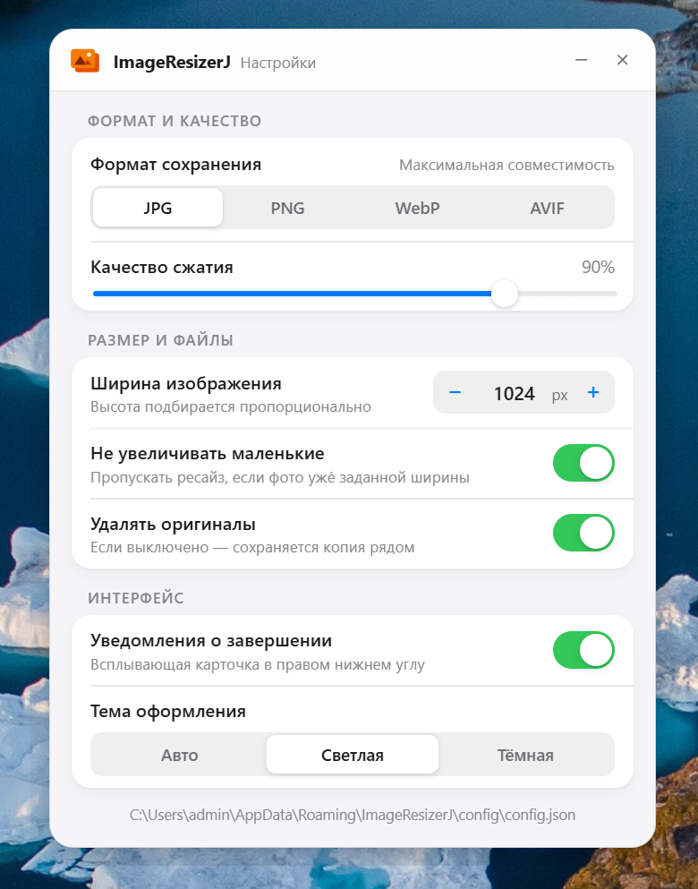

# ImageResizerJ

Быстрая нативная утилита на **Rust** для пакетного сжатия, изменения размера и конвертации изображений прямо из контекстного меню файлового менеджера.




## Возможности

* **Запуск в один клик:** выделяете одно или несколько изображений → ПКМ → **«Сжать с ImageResizerJ»**.
* **Поддерживаемые форматы:**
  * **Чтение:** JPG (`jpg`, `jpeg`, `jpe`, `jfif`), PNG, WebP, HEIC/HEIF (`heic`, `heif`, `hif`), AVIF, BMP, TIFF.
  * **Сохранение:** JPG, PNG, WebP, AVIF.
* **Гибкие настройки:** выбор целевой ширины с сохранением пропорций, защита от увеличения маленьких фото, регулировка качества, опция удаления или сохранения оригиналов.
* **Нативная интеграция с ОС:**
  * **Windows 10 / 11:** современное контекстное меню Проводника (Sparse MSIX + Shell Extension), интерфейс на WebView2, компактные всплывающие уведомления.
  * **Linux (KDE Plasma 6):** сервисное меню Dolphin верхнего уровня, интерфейс на WebKitGTK (X11 и Wayland), нативные уведомления через D-Bus.
* **Минимальная нагрузка:** компактные нативные бинарники без тяжёлых рантаймов; поддержка светлой, тёмной и системной темы.

---

## Установка

Готовые установочные файлы доступны в разделе [Releases](https://github.com/janzimi/imageresizej/releases/latest) (зеркало на [GitVerse](https://gitverse.ru/1oblivka/imageresizej/releases)).

### Windows 10 / Windows 11 (x64)

1. Скачайте `ImageResizerJ_Setup_0.3.3.exe` со страницы релизов.
2. Запустите установщик — он установит приложение, зарегистрирует пункт контекстного меню Проводника и добавит ярлык настроек в меню «Пуск».

### Альт Образование 11.2 / Альт Рабочая станция K (x86_64, KDE Plasma 6)

Скачайте `.rpm`-пакет и установите через `apt-get` (системные библиотеки `libheif` и `webkit2gtk` подтянутся автоматически):

```bash
su -
apt-get install -y /путь/к/imageresizej-0.3.3-alt1.x86_64.rpm
```

### Debian 13 (Trixie) / Ubuntu 24.04+ (x64, KDE Plasma)

Скачайте `.deb`-пакет и установите через `apt` (системные библиотеки `libheif`, плагины HEIC/AVIF и `webkit2gtk` подтянутся автоматически):

```bash
sudo apt install ./imageresizej_0.3.3_amd64.deb
```

### Универсальный архив для Linux (x86_64, KDE Plasma)

Подходит для систем с совместимыми системными библиотеками (`glibc`, `libheif`, `webkit2gtk-4.1`):

```bash
tar -xf imageresizej-0.3.3-linux-x86_64.tar.xz
cd imageresizej-0.3.3-linux-x86_64
./install.sh        # установка для текущего пользователя (~/.local)
# или sudo ./install.sh для установки в /usr/local
```

Для удаления выполните `./uninstall.sh` из той же папки.

**После установки в Linux:**
* Контекстное меню **«Сжать с ImageResizerJ»** доступно в Dolphin при выделении файлов изображений.
* Настройки открываются из меню приложений → **Графика → ImageResizerJ**.

---

## Настройки

При первом запуске создаётся файл конфигурации со следующими параметрами по умолчанию:

| Параметр | Значение по умолчанию |
| --- | --- |
| Формат сохранения | JPG |
| Качество сжатия | 90% |
| Целевая ширина | 1024 px |
| Не увеличивать маленькие | Включено |
| Удалять оригиналы | Включено |
| Уведомления о завершении | Включено |
| Язык интерфейса | Авто (RU / EN по языку ОС) |
| Тема оформления | Авто (системная) |

**Расположение файла конфигурации:**
* **Windows:** `%APPDATA%\ImageResizerJ\config\config.json`
* **Linux:** `~/.config/imageresizerj/config.json`

---

## Структура проекта

* `crates/resizer-core` — чтение/кодирование изображений (включая HEIC/AVIF через `libheif-rs`), ресайз и управление конфигурацией.
* `crates/resizer-worker` — фоновый обработчик пакетных задач и отправка уведомлений.
* `crates/resizer-ui` — окно настроек (и toast-карточка для Windows) на базе `wry` / `tao`.
* `crates/resizer-win-shell` — COM-расширение `IExplorerCommand` для контекстного меню Windows 10/11.
* `packaging/windows` — скрипты сборки Sparse MSIX и установщика Inno Setup 6.
* `packaging/linux` — `.spec`-файл, `.desktop`-интеграция для KDE/Dolphin и скрипты сборки `.rpm`, `.deb` и `.tar.xz`.

---

## Сборка из исходников

### Windows 10 / 11

**Требования:** Rust (MSVC toolchain), Visual Studio Build Tools (C++ и Windows SDK), `vcpkg`, Inno Setup 6.

```powershell
# Установка статической библиотеки libheif (с декодерами HEIC и AVIF)
vcpkg install "libheif[libde265,dav1d]:x64-windows-static-md" --recurse

# Сборка всех компонентов
cargo build --release --workspace

# Сборка MSIX и установщика
powershell -ExecutionPolicy Bypass -File .\packaging\windows\build_msix.ps1
& "C:\Program Files (x86)\Inno Setup 6\ISCC.exe" .\packaging\windows\installer.iss
```

### Debian 13 / Ubuntu 24.04+ (x64)

**Требования:** Rust, `build-essential`, `pkg-config`, `dpkg-dev`, `xz-utils`, `libgtk-3-dev`, `libwebkit2gtk-4.1-dev`, `libheif-dev`.

```bash
# Сборка .deb-пакета и .tar.xz-архива в каталог dist/
./packaging/linux/build_deb.sh
./packaging/linux/build_tarball.sh
```

### Альт Linux (x86_64)

**Требования:** Rust, `gcc`, `pkg-config`, `rpm-build`, пакеты разработки `libheif`, `gtk+3` и `webkit2gtk4.1`.

```bash
# Сборка бинарников и RPM-пакета в каталог dist/
./packaging/linux/build_rpm.sh
```

---

## Лицензия

Проект распространяется под лицензией [MIT](LICENSE).